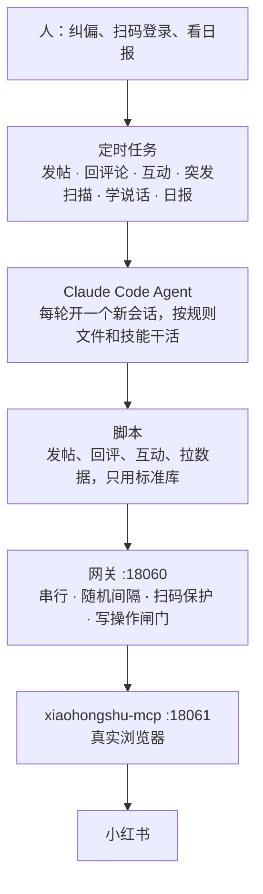

# xiaohongshu-mcp-gateway

让一组 AI Agent 安全地共用一个小红书账号：这是 [xiaohongshu-mcp](https://github.com/xpzouying/xiaohongshu-mcp) 的修改版，另外加了一个全局单例网关。

下面的数字全部来自我们自己在一个真实账号上的运营。

## 我们拿它做了什么

2026 年 10 月起，我们用几个 Claude Code Agent 运营一个足球资讯号（账号名不公开）。选题、写稿、配图、发帖、回评论、去别人帖子下互动、看数据，都由 Agent 完成。人只做三件事：纠偏、扫码登录、看日报。所有对小红书的操作都经过这个仓库里的 MCP 和网关。

## 成绩

| 指标 | 数字 | 口径 |
|---|---|---|
| 发帖 | 300 篇，每天 13～15 篇 | 创作中心，09-27～10-26 |
| 观看 | 51 万次 | 同上 |
| 曝光 | 264 万次 | 同上 |
| 单篇最高 | 6.5 万次观看 | 同上 |
| 和同类作者比 | 观看、互动、涨粉、发布数都超过 99% 的同类作者 | 创作中心账号诊断，10-20～10-26 |
| 回复评论 | 413 条 | 10 月 |
| 去别人帖子下互动 | 154 次 | 10 月 |
| 粉丝 | 从 0 涨到 105，赞藏 7801 | 截至 11-02 |

## 网关在真实运营里的数据

统计范围：网关日志 10-07～11-03，共有 20 天有调用。

- **放行 4622 次调用**：平均每天 231 次，最多的一天 354 次。
- **其中写操作 860 次**：发帖 254、回评论 392、评论别人 54、点赞 159、清 cookie 1。每一次都带了写操作授权头。
- **至少 271 次调用（5.9%）到达时，另一个操作还没做完**，于是在网关里排队，其中 99 次排了 30 秒以上。没有网关的话，这些调用会同时去抢同一个浏览器。（算法：排队时间超过最大间隔 12 秒的，一定是在等别的操作做完，所以这是下限。）
- **2 次没带授权头的写操作被拦下**（10-09 一次点赞，10-19 一次发布）。
- **获取登录二维码 32 次**：登录态会过期，换电脑也要重新扫码。

## 我们怎么用



| 任务 | 频率 | 做什么 |
|---|---|---|
| 发帖 | 白天每小时一轮，具体时间随机 | 每天 13～15 篇 |
| 回评论 | 一天 8 轮 | 每轮最多回 5 条 |
| 互动 | 一天 2 轮 | 每轮最多点 6 个赞、写 2 条评论 |
| 突发扫描 | 每 30 分钟 | 先用脚本机械筛一遍，有候选才叫 Agent |
| 学说话 | 每天 1 轮 | 只看热帖和评论区，把学到的说法记进说话手册 |
| 日报 | 每晚 22 点后 | 拍一次数据快照，发给人看 |

## 相对上游改了什么

1. **登录检测**（`xiaohongshu/login.go`）：小红书给游客也发 `web_session` cookie，旧的 DOM 选择器在改版后又经常失效。现在改成优先读页面里的 `window.__INITIAL_STATE__.user`，能区分游客和真实登录。
2. **全局单例网关**（`gateway/`）：所有调用排队、串行执行；两次操作之间随机间隔 5～12 秒；扫码登录期间暂停其他操作；发布、评论、点赞这类写操作默认拦截。

细节见 [FORK.md](FORK.md) 和 [gateway/README.md](gateway/README.md)。

## 踩过的坑

1. **几个任务同时抢一个浏览器。** 发帖、回评论、扫描各跑各的，同时调 MCP，页面就会被互相打断。所以加了网关，让所有调用串行。上面那 271 次排队，就是网关挡下来的撞车。
2. **换电脑后扫码登录连续失败 4 次**（10-19）。原因是游客也有 `web_session`，旧选择器又找不到元素。改成读 `__INITIAL_STATE__` 以后就好了。
3. **写操作发出去就撤不回。** 网关默认拦截所有写操作，带授权头才放行，日志里拦下过 2 次。我们的做法是：读操作让 Agent 直接调；写操作走脚本，由脚本决定什么时候带授权头。
4. **定时任务断了没人知道。** 10-17、10-25、10-26 这三天几乎没发帖，都是事后才发现。最好加一个提醒：一天发帖太少就通知人。
5. **工具让你发得快，也让你更快被判搬运。** 10 月被提示过一次原创度，有一篇被处置；11 月初又被提示了 3 次「重复、编辑他人帖子」。原因是资讯号的选题、事实、配图如果都来自同一篇转载稿，就会被判成搬运。后来我们在发帖流程里加了两道检查：
   - 每篇至少要有两个信源，其中至少一个是原始出处，配图不用转载站的；
   - 比赛战报只在终场后 24 小时内发，其他新闻 36 小时内发。
6. **流量很集中，涨粉慢。** 观看最多的 10 篇占了全部观看的一半，大约 7000 次观看才涨 1 个粉。能火的是伤病、转会算账、名帅金句、国家队大赛、本地球迷这几类，纯比分战报一篇都没进前 10。

## 快速开始

1. 构建：

   ```bash
   go build -o xiaohongshu-mcp .
   ```

2. 第一次登录，和上游一样：

   ```bash
   go run cmd/login/main.go
   ```

3. 让 MCP 改听 18061，把 18060 留给网关：

   ```bash
   ./xiaohongshu-mcp -headless=true -port=127.0.0.1:18061
   ```

4. 启动网关：

   ```bash
   python3 gateway/xhs_gateway.py
   ```

5. 让 Agent 连网关。地址和上游默认的一样，所以照上游文档配的客户端会自动走网关：

   ```bash
   claude mcp add --transport http xiaohongshu-mcp http://localhost:18060/mcp
   ```

6. 写操作走脚本，确认过再放行：

   ```bash
   python3 gateway/mcpcall.py check_login_status '{}'
   XHS_ALLOW_WRITE=yes python3 gateway/mcpcall.py publish_content '{...}'
   ```

macOS 开机常驻、各项配置，见 [gateway/README.md](gateway/README.md)。

## 致谢和许可

- 基于 [xpzouying/xiaohongshu-mcp](https://github.com/xpzouying/xiaohongshu-mcp) 的提交 `a5c8f77`，上游的提交历史和作者都完整保留。上游原来的 README 在 [README.upstream.md](README.upstream.md)（英文版 [README_EN.md](README_EN.md)）。
- 许可证沿用上游的 Apache-2.0，见 [LICENSE](LICENSE)。
- 自动化操作小红书有违反平台规则、被限流或封号的风险，请自己判断。上面的数字只代表我们这一个账号。

## English summary

This is a fork of [xpzouying/xiaohongshu-mcp](https://github.com/xpzouying/xiaohongshu-mcp). We use it to let a small team of AI agents (Claude Code) run a real football-news account on Xiaohongshu (RedNote). The agents pick topics, write posts, publish, reply to comments and engage with other posts. A human only corrects course, scans the login QR code and reads a daily report.

In the account's first month the agents made 300 posts, which got 510k views and 2.64M impressions. They also replied to 413 comments.

The fork adds two things:

- **Guest-aware login check.** It reads `window.__INITIAL_STATE__.user` instead of relying on DOM selectors or the `web_session` cookie, which guests also receive.
- **Single-instance gateway.** It serializes every tool call and spaces calls 5–12 s apart. It pauses everything else during QR login, and it blocks write operations unless the request carries `X-XHS-Allow-Write: yes`.

Over 20 days the gateway passed 4,622 calls. In at least 271 of them, another call was still running, so the gateway queued the new call instead of letting both hit the shared browser.
